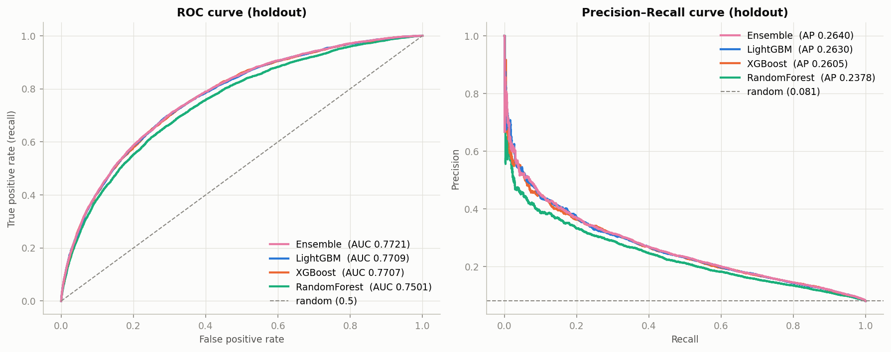
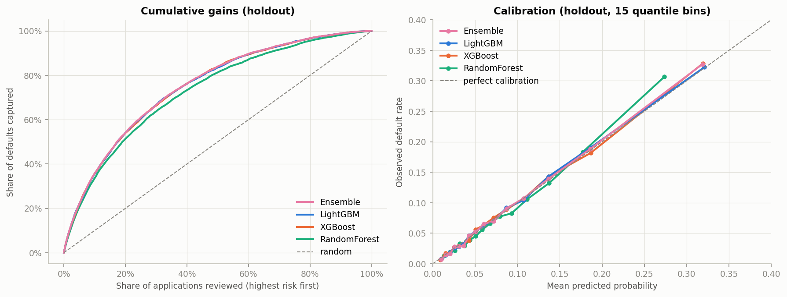
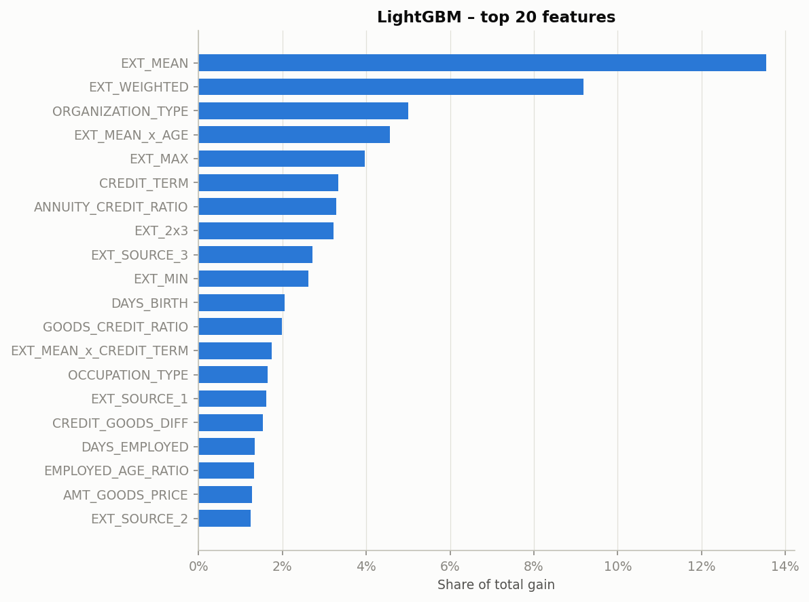

# Home Credit Default Risk – predicting loan default

End-to-end credit risk modelling on the [Home Credit Default Risk](https://www.kaggle.com/competitions/home-credit-default-risk) dataset: exploratory analysis, feature engineering, and a comparison of LightGBM, XGBoost and Random Forest, plus a LightGBM + XGBoost ensemble. The task is to predict which applicants will have payment difficulties. That is a binary classification problem with a heavy class imbalance (only **8.1%** positives).

**Best result:** ROC AUC **0.772** (Gini 0.544) on a stratified 20% holdout, using the main application table only. The model's probabilities are well calibrated, so they can be read directly as a probability of default (PD).

## Results

Holdout set: 61,503 applications, 4,965 defaults. None of these rows were used for training, model selection, the ensemble weight or the decision threshold.

| Model | ROC AUC [95% CI] | Gini | PR AUC | KS | F1* | Brier |
|---|---|---|---|---|---|---|
| **Ensemble (0.6 · LightGBM + 0.4 · XGBoost)** | **0.7721** [0.766–0.779] | **0.544** | **0.264** | **0.405** | **0.321** | 0.0669 |
| LightGBM | 0.7709 [0.764–0.778] | 0.542 | 0.263 | 0.405 | 0.320 | 0.0669 |
| XGBoost | 0.7707 [0.764–0.777] | 0.541 | 0.261 | 0.400 | 0.319 | 0.0670 |
| Random Forest | 0.7501 [0.743–0.757] | 0.500 | 0.238 | 0.369 | 0.303 | 0.0682 |

<sub>* F1 is measured at the threshold that maximises F1 on out-of-fold predictions; that threshold is then applied to the holdout unchanged. Confidence intervals come from a bootstrap with 500 resamples.</sub>



### What the model means in practice

With the ensemble at its max-F1 threshold (0.152):
- **14.0%** of applications are flagged as high risk, and they contain **43.8%** of all defaults.
- Precision is 25%, about **3.1×** the base default rate.
- The riskiest 10% of applications contain **35.7%** of all defaults (lift 3.6).



## Key findings

**1. Class weights do not help with imbalance; threshold choice does.**
I compared three settings of `scale_pos_weight` in LightGBM: none, √(neg/pos) and neg/pos.
- Ranking quality barely changed: OOF AUC was 0.7660, 0.7659 and 0.7643.
- With full weighting, the mean prediction rose from 0.08 to 0.38 and the Brier score worsened from 0.068 to 0.180. The probabilities no longer meant anything.
- The higher recall of weighted models at a 0.5 cut-off came entirely from that shift in scale. Lowering the threshold on the unweighted model gave the same F1 (about 0.31).
- **Decision:** no class weights, with the threshold tuned on OOF predictions. The models stay calibrated, which matters when the output is used as a PD.

**2. LightGBM and XGBoost are statistically tied; Random Forest is clearly behind.**
- The AUC difference between LightGBM and XGBoost is −0.0002, with a 95% CI of [−0.002, +0.001].
- LightGBM trains about 3× faster.
- Random Forest is 0.021 AUC worse, and that gap is significant.

**3. The ensemble gives a small but consistent gain.**
- It adds +0.0012 AUC over LightGBM, with a CI of [+0.0006, +0.0019], and beats the better single model in 5 of 5 CV folds.
- The gain is small because the two models' predictions are 0.97-correlated.
- The blending method barely matters: a 50/50 mean, a rank average and an OOF-tuned weighted mean all score 0.7721–0.7722.

**4. Feature engineering is what drives performance.**
- It added +0.009 OOF AUC (0.7598 → 0.7688) with the same number of features, and the gain held in all 5 folds.
- Engineered features account for about 67% of LightGBM's total gain.
- The strongest signals are combinations of the external credit scores (`EXT_SOURCE_1/2/3`). Credit-to-annuity ratios are weak on their own (univariate AUC 0.53) but reach the top 10 through interactions.



## Approach

### 1. Exploratory data analysis – [`eda.ipynb`](eda.ipynb)
- The data has 307,511 applications × 122 columns. 67 columns have missing values; the 47 building-related columns are 47–70% empty.
- `DAYS_EMPLOYED = 365243` is a placeholder used almost exclusively for pensioners (18% of rows). This group's default rate is lower: 5.4%.
- The external scores `EXT_SOURCE_1/2/3` are by far the strongest predictors, with univariate AUC of 0.66–0.68. Their mean already reaches 0.72.
- The notebook also covers default rates by category, age and income effects, and correlation analysis.

### 2. Feature engineering – [`feature_engineering.ipynb`](feature_engineering.ipynb)
- **Cleaning:**
  - placeholder values (`365243`, `XNA`, `Unknown`) are turned into NaN plus indicator flags;
  - outliers are clipped at the 99.9th percentile, with bounds fitted on the training data.
- **50 new features in 6 groups:**
  - `EXT_SOURCE` aggregates: mean, weighted mean, min/max, products, interaction with age;
  - financial ratios: credit term, annuity/income, goods/credit;
  - time features: age, employment length as a share of age, age at loan end;
  - counts of documents, contact flags and credit bureau enquiries, plus default rates in the applicant's social circle;
  - missing-value counts;
  - group-relative features, i.e. a value divided by its median in the applicant's occupation or organisation.
- **Reduction:** 53 columns were dropped: near-constant flags, duplicated `_MODE`/`_MEDI` building statistics, and one column from each pair with |r| > 0.99.
- **Encoding:**
  - binary columns are mapped to 0/1;
  - 11 categoricals use the native `category` dtype;
  - high-cardinality columns also get frequency encoding;
  - dtypes are downcast, which cut memory from 240 MB to 107 MB.
- **No leakage:** every fitted transformation (clip bounds, group medians, encoders) is fitted on training data, saved as an artifact and only applied to new data.

### 3. Modelling – [`modeling.ipynb`](modeling.ipynb)
- **Validation:**
  - a stratified 80/20 holdout split;
  - 5-fold stratified CV on the 80% part, with early stopping on AUC;
  - the final model uses the mean best iteration × 1.1 trees and is retrained on the whole 80%.
- **Imbalance:**
  - stratified splits;
  - metrics that work under imbalance (ROC AUC, PR AUC, KS, capture rate) rather than accuracy;
  - the class-weight experiment described above;
  - an OOF-tuned decision threshold.
- **Models:**
  - LightGBM and XGBoost (`hist`) with native categorical support;
  - Random Forest on integer-coded categoricals, using sklearn's native NaN handling;
  - the ensemble's blend weight is chosen on OOF predictions.
- **Evaluation:**
  - bootstrap confidence intervals and paired fold-by-fold comparisons;
  - ROC/PR curves, confusion matrices, cumulative gains and lift, calibration, feature importance, CV stability and training time.

## Repository structure

```
├── eda.ipynb                    # 1. exploratory data analysis
├── feature_engineering.ipynb    # 2. cleaning, feature construction, encoding
├── modeling.ipynb               # 3. model training, comparison, ensemble
├── scripts/
│   └── make_figures.py          # regenerates the README figures from saved predictions
├── reports/figures/             # figures used in this README
├── requirements.txt
└── data/                        # not tracked – see "How to run"
    ├── application_train.csv
    └── processed/               # created by the notebooks (features, models, predictions)
```

The notebook commentary is written in Polish. Code, variable names and chart labels in this README are in English.

## How to run

1. **Get the data.** The dataset cannot be redistributed under the Kaggle competition rules, so download it yourself. Accept the [competition rules](https://www.kaggle.com/competitions/home-credit-default-risk/rules) first. Then put `application_train.csv` in `data/`. With the Kaggle CLI:
   ```bash
   kaggle competitions download -c home-credit-default-risk -f application_train.csv -p data
   ```
   If the file arrives as a `.zip`, unzip it into `data/`.
2. **Install dependencies.** The project was tested with Python 3.13.
   ```bash
   pip install -r requirements.txt
   ```
3. **Run the notebooks in order.** Each one reads the outputs of the previous one from `data/processed/`. Feature engineering takes about 3 minutes and modelling about 12 minutes on a laptop CPU.
   ```bash
   jupyter nbconvert --to notebook --execute --inplace eda.ipynb
   ```
   ```bash
   jupyter nbconvert --to notebook --execute --inplace feature_engineering.ipynb
   ```
   ```bash
   jupyter nbconvert --to notebook --execute --inplace modeling.ipynb
   ```
4. *(Optional)* **Regenerate the README figures:**
   ```bash
   python scripts/make_figures.py
   ```

All random seeds are fixed (`SEED = 42`), so the metrics reproduce exactly. Only training times vary between runs.

## Limitations and next steps

- **Only the main application table is used.** The competition also provides credit bureau history, previous applications and instalment payments. Aggregating them typically lifts AUC to about 0.79. This is the largest expected gain.
- **No hyperparameter tuning yet.** All models use sensible defaults, so the comparison between algorithms is fair. Tuning with Optuna usually adds +0.002–0.005 AUC.
- **The threshold is F1-based.** A business threshold should come from expected loss on a default versus lost margin on a rejected good client.
- **Explainability:** per-applicant SHAP explanations would make the model suitable for credit decisions and adverse-action reasons.
